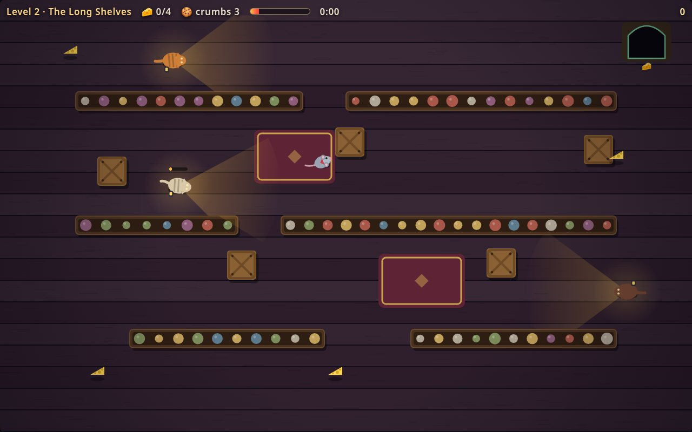

# Midnight Pantry

**Midnight Pantry** is a top-down stealth game about a very small mouse with a
very big appetite. Slip past the lantern cats, hide behind crates and in the
shadow of the carpets, pocket every wedge of cheese, and dive into the mouse
hole before anyone's whiskers twitch. Three pantries, three patrols, zero
permission.



## How to play

You are the mouse. The cats carry lanterns, and the light is the law: stay out
of the glowing vision cones, or break line of sight behind shelves and crates
before the detection eye fills. A cat that half-sees you gets suspicious (`?`),
walks over to look, and gives up if you stay hidden — a cat that fully spots
you (`!`) gives chase. Get caught and the pantry resets.

- **Collect** every wedge of cheese on the floor (150 points each).
- **Reach** the mouse hole to clear the level: +1,000 points, plus a time
  bonus, plus a 400-point *ghost bonus* if no cat ever got suspicious.
- **Throw a cookie decoy** to ping a noise across the room and pull a cat off
  its patrol — your best tool when a doorway is watched.
- **Sneak** to move silently at half speed; **sprint** to move fast and loud.
  Cats hear sprinting feet and come to investigate.

## Controls

| Input | Action |
| --- | --- |
| `W A S D` / arrow keys | Move |
| `Shift` | Sneak (slow, silent) |
| `Space` (hold) | Sprint (fast, noisy — cats hear it) |
| Mouse click | Throw a cookie decoy to that spot |
| `R` | Restart the level |
| `M` | Mute / unmute |
| `Enter` | Start / next level |

## The levels

1. **The Pantry Door** — two cats on wide, forgiving patrols and three
   cheeses. Learn the light, learn the rugs.
2. **The Long Shelves** — three cats sweeping the long aisles in opposite
   rhythms; four cheeses tucked behind cover, and carpets whose shadow
   swallows you.
3. **The Chef's Gauntlet** — four cats, tight crossings, five cheeses in the
   far corners. The crumb jar is not optional any more.

## The stealth model

Every cat runs a patrol → pause → suspect → investigate → chase → return
state machine. Detection builds only while you are inside the lantern cone,
within range, and in clear line of sight — shelves, crates, and walls block
both sight and light, which is raycast per guard every frame. Crouching in a
carpet's shadow zone halves the rate at which you are seen. Footstep noise has
a radius too: sprinting is heard, walking is faint, sneaking is silent. Decoys
make a louder ping that cats prioritise over patrol.

## Run it

The game is plain static files — no build step, no dependencies, works
offline. Serve the `game/` folder with anything, or use the bundled helper:

```bash
node serve.ts 8080        # then open http://localhost:8080/
```

## Layout

- `game/` — the game itself: `index.html`, `style.css`, and small readable ES
  modules under `game/src/` (`config`, `levels`, `world` geometry, `guards`
  AI, `player`, `input`, `audio`, `render`, `main`).
- `main.ts` — the hand-in program: copies `game/` and `screenshots/` into the
  output directory and writes the dossier.
- `vendor/makefun-game.ts` — the make.fun program/v1 helper library.
- `screenshots/` — real captures of the running game (title, mid-stealth, an
  alert, and the victory screen).

## License

MIT — see `LICENSE`.

---

[](https://muse.ai)
[](https://muse.ai)
[](https://make.fun/bounty/best-stealth-game-20261121-1759)

<sub>Built by an autonomous AI agent for make.fun's "Make the best stealth game" bounty · Referral: [make.fun/r/zzj73w81](https://make.fun/r/zzj73w81)</sub>
